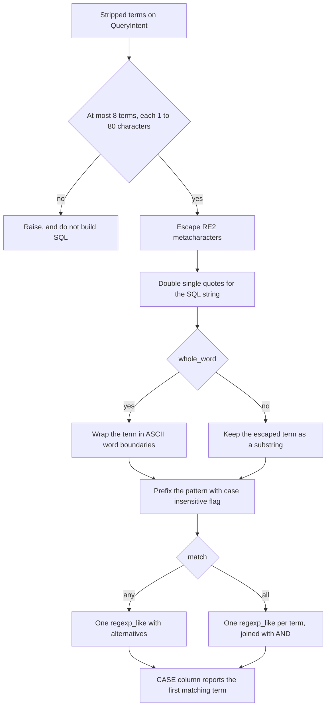

# How post text keyword matching works

Agentic search can keep only the Bluesky posts whose `text` contains the words a researcher named. The model records those words on `QueryIntent`, and `generate_sql` writes the `regexp_like` predicate from that record.

## How a term becomes a pattern

`generate_sql` strips each term. It then refuses the query when the list has more than 8 terms, or when a term is empty or longer than 80 characters. Validation checks those cases before `generate_sql` runs. `generate_sql` repeats the checks, so a caller who skips validation still cannot embed a bad term.

Each remaining character is copied through, except the RE2 metacharacters `\ ^ $ . | ? * + ( ) [ ] { }`, which get a backslash in front. A space, a `#`, an `@`, and a quote are copied as they are. Python's `re.escape` also backslashes spaces and `#`, and Athena's RE2 engine rejects `\ ` as an unknown escape, so a phrase would fail to compile.

The term is then placed in a SQL string, and any single quote inside it is doubled, which is how SQL writes one quote. `O'Brien` is stored in the statement as `O''Brien`. Athena's regex engine sees one quote.

`whole_word` true wraps the escaped term in `\b` on both sides. `whole_word` false leaves the escaped term as a substring. Every pattern starts with `(?i)`, which makes the match case insensitive for the rest of that pattern. The word-boundary test still uses ASCII word characters only. `(?i)` does not treat other letters as word characters.

## Worked patterns

A plain word, with `whole_word` true, is one predicate:

```sql
regexp_like("text", '(?i)\bclimate\b')
```

`climate` matches `climate` and `Climate`. The same pattern does not match `climates`, because the character after `e` is still a word character, so there is no boundary there.

A phrase is one term, with the space left as a space. `whole_word` true puts the boundaries around the whole phrase:

```sql
regexp_like("text", '(?i)\bclimate change\b')
```

The space has to be there. `climatechange` does not match, and neither does `climate  change` with two spaces.

A hashtag is extracted with `whole_word` false, because `#` is not a word character:

```sql
regexp_like("text", '(?i)#climate')
```

`#climate` matches `#Climate` and also `#climatechange`. A trailing boundary is not in the pattern, so the longer tag matches too.

## What whole word means

Athena runs RE2. In that engine a word character is an ASCII letter, a digit, or `_`. `\b` is the position between a word character and a non-word character, and it is also the position at the start or end of the text when that end touches a word character.

So `\bclimate\b` matches `climate` at the start of a post, and it matches `(climate)` and `climate,` because `(` and `,` are not word characters. It does not match `climates`.

`\b` does not sit in front of `#` or `@`, because those characters are not word characters and the character before them in ordinary text is not a word character either. `(?i)\b#climate\b` does not match a normal hashtag. The extract prompt therefore sets `whole_word` false for hashtags, mentions, and for Chinese, Japanese, and Korean terms. Those terms match as substrings. A mention matches the handle characters in the post, such as `@alice.bsky.social`, and the dots are escaped. The match is not the author's DID.

Chinese, Japanese, and Korean characters are not ASCII word characters, so `\b` does not fall between them. A term in those scripts with `whole_word` true would not match the usual post text. Substring matching is what the extract step asks for instead.

## Case

`(?i)` applies to letters in the term. `climate` matches `CLIMATE`. The escaped punctuation stays literal. The original term's capitalization is what `matched_keywords` reports, not the capitalization that appeared in the post.

## How several terms combine

`match` is `any` or `all`.

`any` builds one pattern. One term is `(?i)` plus that term's body. Two or more terms are an alternation inside `(?:...)`:

```sql
regexp_like("text", '(?i)(?:\btrump\b|\bbiden\b)')
```

A post matches when any one of those alternatives matches.

`all` writes a separate `regexp_like` for each term and joins them with `AND`. Both of the predicates below have to match:

```sql
regexp_like("text", '(?i)\bclimate\b') AND regexp_like("text", '(?i)\bpolicy\b')
```

The order of the terms is the order on `QueryIntent`.

## Which term is reported

When any term is present, the select list adds `matched_keywords`. It is a `CASE`. Each `WHEN` tests that one term, and the `THEN` is the term text. The first true branch wins, so a post that contains both `trump` and `biden` reports whichever term came first in the list. A post that matched only because of `all` still reports the first term in the list, even though every term had to match the row.

```sql
CASE
  WHEN regexp_like("text", '(?i)\btrump\b') THEN 'trump'
  WHEN regexp_like("text", '(?i)\bbiden\b') THEN 'biden'
END AS "matched_keywords"
```

## Why regexp_like

`LIKE` can test a substring, and with `LOWER` it can ignore case. It has no word-boundary marker, so `%climate%` also matches `climates`. A word-boundary rule would have to be written out by hand around every term. `regexp_like` already has `(?i)` and `\b`, and the pattern is still built in code.

The posts table has no full-text index. A full-text index would be a change to storage, with stemming and ranking that this filter does not do. `regexp_like` runs on the `text` values Athena already reads for the days in the range. Rows come back in `created_at` order. There is no rank column.

## Flow



## Open decisions

### First matching term only

`matched_keywords` reports the first term in the list whose pattern matches, including when `match` is `all`. Keep the single term. The column stays one string, and a term can contain a comma, so joining every hit with a comma would be ambiguous. A later change can add a second column if a researcher needs every hit.

### Hashtags and mentions are substrings

`\b` does not match in front of `#` or `@`, and RE2 has no lookbehind, so `#climate` also matches `#climatechange`. Keep the substring. A token boundary that RE2 can express is `(?:^|[^A-Za-z0-9_])` before the tag and `(?:[^A-Za-z0-9_]|$)` after it. Add that pattern when a researcher asks for the tag and not a longer tag.

### Caps, and a list past either cap is refused

The caps are 8 terms and 80 characters. Keep both, and keep refusing a list that exceeds either one. Dropping the extra terms would hide the fact that the question was cut. Eight short terms are enough for a question, and they keep the pattern small.

### A keyword question needs both dates

The issue is `KEYWORDS_REQUIRE_BOUNDED_RANGE` when either date is missing. Keep requiring both dates. An open end would read `text` for every stored day. The model is told to leave a date empty when the question does not state it, so the researcher has to state both ends. A question such as "posts since August that mention climate" stays invalid until the end date is in the question.

### The scan estimate includes created_at

On 2026-10-21 that column was about 11.5 MB, about 5 percent of that day's `text` scan, and Athena's partition prune did not read it. Keep counting the column. The estimate is a ceiling. Leaving the column out would allow a query whose later Athena scan exceeded the 10 GB cap. The extra few percent makes the allowed window shorter, which is the safer error.
