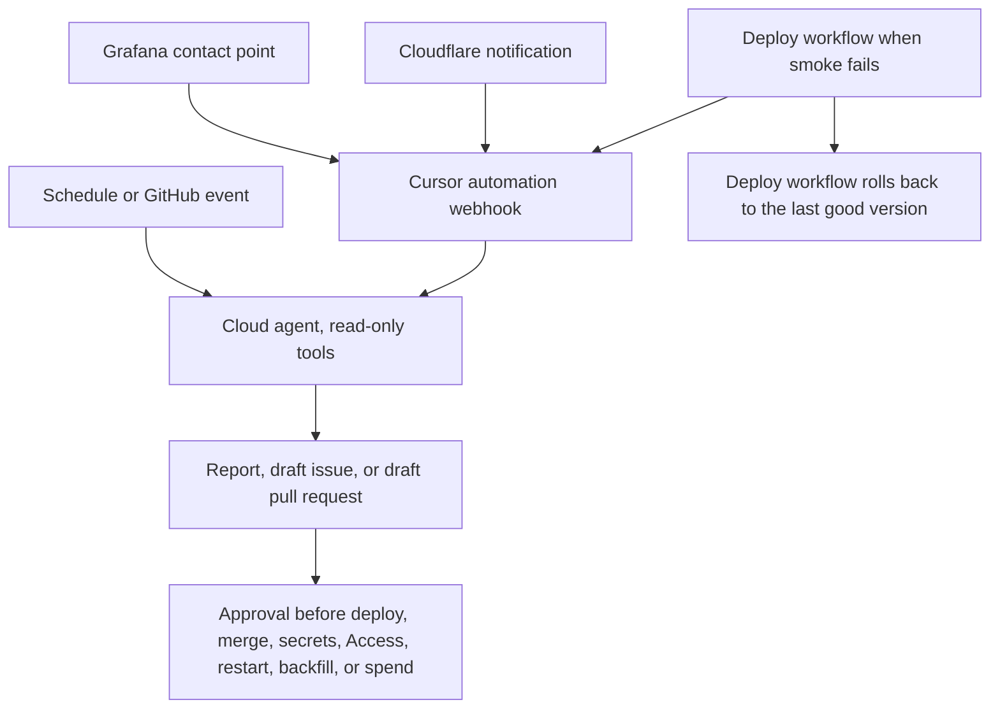

# SRE agents

[Overview](plan.md). The agents read production signals and write a report or a draft pull request. They do not deploy, merge, or spend money. The five playbooks are draft prompt text in [draft_prompts/](draft_prompts/). Nothing in the repo runs them.

## Where the prompt files live

The repo does not keep agent prompts in a `prompts/` directory. Application prompt text for the collector lives in `collector/prompts.py`, which is Python, not a folder of automation prompts. The drafts are markdown next to this plan so a review can read the full text without looking like the automations are already configured. When you wire an automation, copy the matching file into the automation's prompt field. Do not treat the markdown path as a runtime input.

## Architecture

Grafana, Cloudflare notifications, and the deploy workflow call a Cursor automation webhook. A schedule can start an automation without a webhook. The agent uses read-only AWS, Cloudflare, and Grafana tools, then writes a report or opens a draft issue or a draft pull request. A person approves anything that changes a running system or spends money. The one exception is the deploy workflow itself, which may roll back to the last good version when the smoke that runs after the deploy fails. The agent recommends the rollback and does not run it.

Cursor documents the triggers at [Automations](https://cursor.com/docs/cloud-agent/automations) and in the [automations announcement](https://cursor.com/blog/automations). Triggers include a schedule, GitHub events, PagerDuty, Sentry, and a private webhook with a bearer key. This plan uses the schedule, GitHub, and the webhook. It does not add PagerDuty or Sentry. Cloudflare notification webhooks are documented at [configure webhooks](https://developers.cloudflare.com/notifications/get-started/configure-webhooks/).

The source notes also name a Grok Bot routine for the daily digest. The repo has no Grok Bot config. The digest playbook is the same report either way. If you add the Grok Bot routine, point it at [the digest prompt](draft_prompts/05_daily_health_digest.md) and do not give it a second, shorter prompt.

## What the agent may do without approval

The agent may read logs and metrics, rerun `scripts/cloudflare_smoke.py`, read Athena metadata, and read Secrets Manager names. It may write a report, open a draft issue, or open a draft pull request. Secret values stay out of the report. The agent refers to a secret by name, and when it compares values it compares hashes.

`scripts/cloudflare_smoke.py` is on [PR #245](https://github.com/METResearchGroup/lab_data_integrations_interface/pull/245) only. Until that file is on `main`, the agent cannot rerun it from a checkout of `main`.

## What needs approval

A person approves a deploy, a rollback, a merge, a secret change, an Access or WAF change, a container restart or stop, starting a backfill, and any change that spends money. The agent can recommend those actions in the report.

The exception is narrow. When the deploy workflow's own smoke fails, that workflow may roll back to the last good version without waiting for the agent. The [deploy smoke playbook](draft_prompts/02_deploy_smoke_failed.md) still only recommends a rollback. It does not run one. Whether `wrangler rollback` restores the container image is [not verified](plan.md#not-verified), so the workflow's rollback step has to name the artifact it restores.

## Guardrails

- Use a separate read-only AWS role and a read-only Cloudflare token. Do not give the agent the deploy token.
- Secrets by name only. Hashes are allowed. Values are not.
- The source notes ask for `grok-4.7` on the high setting for these automations. Set that on the automation. The prompt files do not repeat a model pin, so a model change does not require editing five files.
- Cap how many runs can start per day, and cap how long one run may last. Pick the numbers when you create the automation, and write them in the automation's description. The notes did not choose a number.
- Do not paste private payloads, tokens, or user queries into an issue or a pull request. A search-pipeline report may include counts and reasons. It may not include the query text or the email body.
- Do not copy these prompts into a client that has permission to deploy.

## The five playbooks

| Playbook | When it runs | What it is allowed to change |
| --- | --- | --- |
| [Jetstream stalled or OOM](draft_prompts/01_jetstream_stalled_or_oom.md) | Cursor age above 10 minutes, or an OOM restart | Nothing live. A draft pull request if the cause is a config value in git. Restart stays behind approval. |
| [Deploy smoke failed](draft_prompts/02_deploy_smoke_failed.md) | The deploy workflow's smoke job fails | A draft pull request with a proposed fix. Rollback is a recommendation, plus the workflow's own automatic rollback when that step exists. |
| [Cost spike](draft_prompts/03_cost_spike.md) | Budget or Athena or OpenAI spend alert | Nothing. The report names the top queries by bytes scanned and the top callers, and it suggests limits. |
| [Nightly config drift](draft_prompts/04_nightly_config_drift.md) | A schedule, once a night | Nothing. The report lists names whose hashes differ. |
| [Daily health digest](draft_prompts/05_daily_health_digest.md) | 08:00 America/Chicago | Nothing. The report is the digest. |

## Setup

Do the steps in order. Steps 1 and 2 are the same work as the first telemetry and DevOps items, and they depend on #245 for anything that mentions a Worker.

1. In Grafana, add the Cloudflare log and trace destinations, add the CloudWatch data source with a read-only role, and add synthetic HTTP checks for the UI, `GET /health`, and an authenticated `POST /query`. The authenticated check needs the test Supabase user. Do not put the user's password in the dashboard JSON.
2. In wrangler, set the Grafana destinations with `persist: false`. Set `OTEL_EXPORTER_OTLP_HEADERS` as a secret on each container Worker. #245 forwards the secret when it is non-empty and does not create the destination.
3. At [cursor.com/automations](https://cursor.com/automations), create one automation per playbook. Paste the matching file from [draft_prompts/](draft_prompts/). Attach Grafana and the read-only AWS and Cloudflare tools. Copy the webhook URL and the bearer key into the password manager you already use for this lab. Do not commit them.
4. In Grafana, add one webhook contact point per automation. Send the bearer key. Strip a trailing newline from the URL before you save it. A trailing newline returns HTTP 400, and a scheduled run of the same automation can still succeed ([forum thread](https://forum.cursor.com/t/automation-webhook-returns-http-400-while-scheduled-trigger-works/171792)).
5. In the GitHub deploy workflow, call the deploy-smoke automation webhook when the smoke job fails. The workflow file does not exist yet. See [DevOps item 1](devops.md#1-deploy-workflow-with-an-authenticated-smoke).
6. Optionally add the Grok Bot daily digest routine, using the same digest prompt.
7. Optionally turn on Cursor Bugbot for pull request review ([Bugbot](https://cursor.com/bugbot)). Pricing is [not verified](plan.md#not-verified). Bugbot is a reviewer, not one of the five playbooks.
