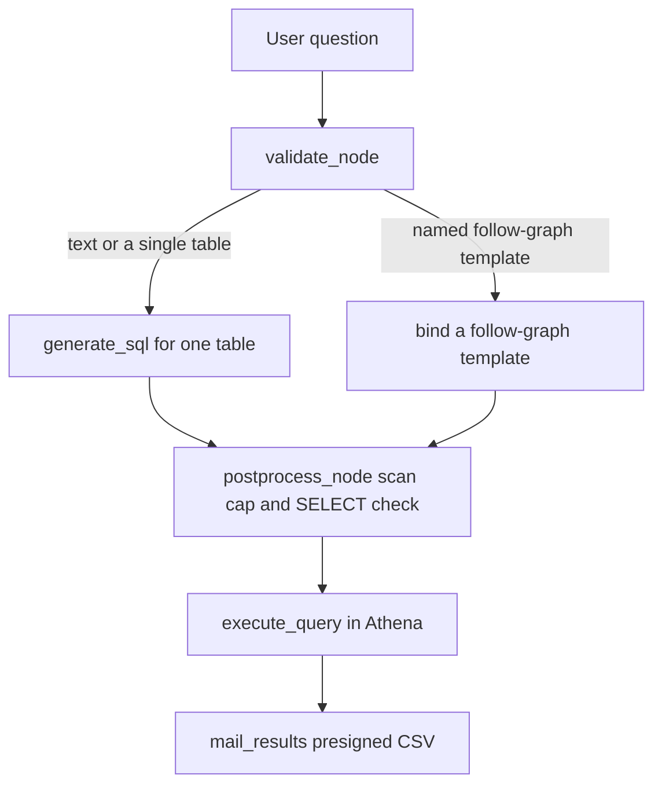
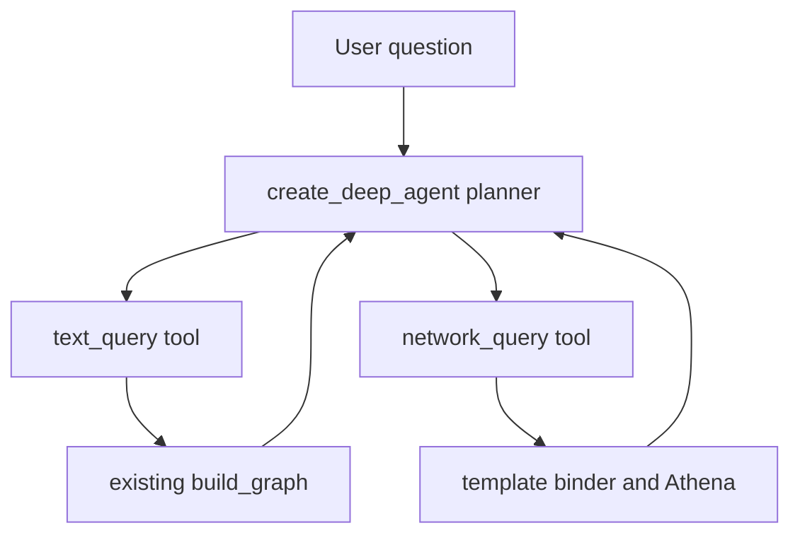

# Proposal: network science queries over the Bluesky follow graph

Scope: [issue #275](https://github.com/METResearchGroup/lab_data_integrations_interface/issues/275). This proposal decides the query catalog, what the warehouse can answer today, how to turn follow events into edges, which engine to use, how the agent should call that engine, and the first pull requests. It leaves commands, tests, and line-by-line edits for an implementation plan after the decisions in section 8 are confirmed.

## Overview

Nicholas Ornstein wants, for two accounts A and B, the number of accounts that A follows who also follow B. He also wants the list of accounts a given account follows. He asked whether the warehouse already holds those lists, or only the follow events it has seen since early August 2026. The live table holds follow creates from that window. It does not hold unfollows, and it does not hold the follows that already existed when collection started.

The overlap query is a join of two edges, `A → x` and `x → B`. On a table of ties created since 2026-08-01, Athena can run that join for cents a query, inside the scan cap the text agent already enforces. A graph database does not change the answer, and the cheapest managed graph databases cost more per month than the whole app does today.

The first version should answer Nick's overlap query, and the new-ties study he said he can run on this data, with a fixed SQL template and the email delivery the app already uses. Recording unfollows, and any snapshot of older follows, comes after that query works and after Nick confirms the columns he wants. Community detection and centrality stay as a later batch export to a graph library. LangChain Deep Agents stays a later option for questions that have to plan across text search and the follow graph in one turn.

## 1. The problem and the target queries

A follow is a directed tie. In the warehouse the follower is `did` and the account they follow is `subject_did`. Nick's sentence, "how many of the users A follows also follow B", is the count of distinct `x` such that both `A → x` and `x → B` are present. It is not the count of accounts that A and B both follow, and it is not the count of accounts that follow both A and B. Those three counts use the same table and different join keys, so the catalog below keeps them apart.

He builds this count today by listing A's follows in the Bluesky API and testing each one. That loop gets hard once A follows more than about 30,000 accounts. He says follower counts reach the millions, while an account following more than 10,000 others is rare. The published full-network snapshot described in section 3 has a mean of about 70 follows per account, which matches that shape. The expensive side of a careless query is the in-neighborhood of a widely followed account. The cheap side is the out-neighborhood of A, which stays in the tens of thousands.

The observation window is the other limit. Section 2 shows that `bluesky_raw.follows` is follow creates from the Jetstream cutover, not a picture of the network on the day collection started. Any query that needs a tie which was created earlier, and never touched again, is missing that tie. The labels below use three words for that limit.

- **Full** means the query is correct for the definition we state, on the rows we actually stored.
- **Partial** means the number is low, or otherwise biased, because ties from before the window are absent.
- **Not answerable** means the definition needs the graph as it was before 2026-08-01, which we do not have.

Nick already said a study of new ties only is useful. For that definition, a tie counts when we stored its create. That study is the one the current table can support without a backfill.

### Query catalog

| Query | Definition | SQL shape on `edges(did, subject_did)` | Tractable on events since the cutover | What dominates the cost |
| --- | --- | --- | --- | --- |
| Overlap, A then B | Count of `x` with `A → x` and `x → B` | `e1.did = A` joined to `e2.did = e1.subject_did` and `e2.subject_did = B` | Full for ties we stored. Partial as a picture of the live network until older follows are snapshotted and unfollows are applied | Out-degree of A, then a lookup of `(x, B)` for each `x` |
| Follow list of A | Every `subject_did` that A follows | `WHERE did = A` | Full for stored creates. Partial against the live list until a snapshot fills older follows | Out-degree of A, at most a few tens of thousands of rows |
| Mutual follow | Both `A → B` and `B → A` | Two point lookups | Full when both creates were stored. A missing older side makes a true mutual look one-way | Two lookups |
| Common follows | Count of `x` with `A → x` and `B → x` | Join `e1` and `e2` on `subject_did`, with `e1.did = A` and `e2.did = B` | Same window limit as the overlap query | Out-degree of A and of B |
| Common followers | Count of `x` with `x → A` and `x → B` | Join on `did` where the two `subject_did` values are A and B | Partial, and often huge, because in-degree is the large side and older followers are missing | In-degree of A and of B |
| Jaccard on follow lists | Size of the intersection of the two follow lists, divided by the size of the union | The common-follows count, plus the two out-degrees | Same as common follows | Out-degree of A and of B |
| Ego network, 1 hop | Accounts A follows, or accounts that follow A | One filter on `did` or on `subject_did` | Out-list is the cheap one. In-list is partial and can be millions of rows | The degree of that one side |
| 2-hop neighborhood | Accounts reachable by two follows from A | `A → x` joined to `x → y` | Full on stored edges, and large. A second hop from 10,000 intermediates can touch on the order of 10,000 times 10,000 edge checks | Sum of the out-degrees of A's followees |
| New ties over time | Follow creates in the window, by day | `GROUP BY` the day of `created_at` | Full for "first time we saw this create". Not the first follow those two accounts ever had | A scan of the days in the range, which is how the table is already partitioned |
| Triadic closure | A third follow that closes two follows already present, for example `A → B`, `A → C`, then later `B → C` | A three-way join with an order on `created_at` | Full only when all three creates fall inside the window. The count of open triads at the start of the window is not answerable | Wedges, which grow with out-degree |
| Reciprocity | Share of stored follows that also have the reverse follow | Self-join of the edge table on the swapped pair | Partial. Missing older follows move the rate in either direction | A full scan of the edge table |
| Degree distribution | Histogram of out-degree, or of in-degree | `GROUP BY did` or `GROUP BY subject_did` | Partial. In-degree of accounts that were already widely followed is the most distorted | A full scan, unless a daily rollup already exists |
| Communities on a subgraph | Leiden or Louvain on an induced subgraph Nick names | Export the edges, then run a graph library | Partial, on whatever edges the export contains | Memory for that subgraph, not Athena |
| Centrality on a subgraph | PageRank, or betweenness, on that same export | Same export | Partial. Betweenness is much more expensive than PageRank because it searches shortest paths | Vertices times edges for betweenness |

The overlap query in SQL, using the column names already on `bluesky_raw.follows`, is:

```sql
SELECT COUNT(DISTINCT e1.subject_did) AS overlap
FROM bluesky_raw.follows AS e1
JOIN bluesky_raw.follows AS e2
  ON e2.did = e1.subject_did
 AND e2.subject_did = :B
WHERE e1.did = :A
```

The list behind the count is the same join with `SELECT DISTINCT e1.subject_did`. A graph engine writes the same pattern as a two-step walk, `A -FOLLOWS-> x -FOLLOWS-> B`. igraph writes it as the intersection of A's successors with the predecessors of B.

Athena, on a table partitioned or bucketed by `did`, can answer the follow list, the mutual check, the overlap, common follows, Jaccard, the 1-hop out-network, and a daily count of new ties. Common followers and in-degree want a second layout keyed by `subject_did`, because a filter on the account being followed does not match a partition on the follower. Two-hop expansion, triad counts, and a global reciprocity rate are still SQL, and they scan much more. Leiden, Louvain, PageRank, and betweenness should be computed with a graph library on an exported subgraph. PageRank is a repeated pass over the edges. Betweenness, in the usual Brandes algorithm, does much more work per vertex, so it should stay on a subgraph Nick has already cut down.

The agent should not write this SQL, and it should not write Cypher, for each question. A fixed template per row of the catalog keeps the join direction, the active-edge rule, and the scan cap in code. A generated query can swap "follows" with "followed by", drop `DISTINCT`, or walk two hops from a celebrity account. The template list for the first version is `overlap_out_to_b`, `list_following`, `common_following`, `mutual`, `jaccard_out`, and `new_ties_by_day`.

## 2. The current state

### Follow events

Live collection is the Jetstream consumer in `bluesky_ingestion_jetstream/`. `WANTED_COLLECTIONS` asks the socket for `app.bsky.graph.follow` along with posts, likes, and reposts (`bluesky_ingestion_jetstream/constants.py`). `parse_follow` keeps one field from the record, `subject` as `subject_did` (`bluesky_ingestion_jetstream/event_parsing/follows.py`). `parse_shared` adds `uri`, `did`, `cid`, `rev`, `created_at`, and `ingested_at` (`bluesky_ingestion_jetstream/event_parsing/shared.py`). The Arrow schema is those fields plus `run_id` (`FOLLOW_SCHEMA` in `bluesky_ingestion_jetstream/schemas/arrow_schemas.py`). There is no handle column and no operation column.

`process_commit_event` returns nothing unless `commit.operation` is `create` (`bluesky_ingestion_jetstream/network/connection.py`). An unfollow on Bluesky is a delete of the follow record, not a second record type. Those deletes are discarded before a row is built. `strategy_planning/2026-07-24_bluesky_event_schemas.md` already notes that `operation` was left off the table because the filter makes every stored row a create. The same filter drops updates.

`created_at` also has to sit within seven days before `ingested_at`, or one day after it (`MAX_CREATED_AT_BACKDATE` and `created_at_in_window` in `event_parsing/shared.py`). A live follow create passes that test. A replayed event passes it when the socket time and the record time move together. A row whose record time is far from the event time is dropped.

The issue says collection starts around 10 August 2026. The code's cutover is `DATA_START_DATE = date(2026, 8, 1)` in `bluesky_ingestion_jetstream/constants.py`, with the split explained in `strategy_planning/2026-08-18_combining_backfill_and_jetstream.md`. The changelog records the Jetstream consumer, including follows, on 2026-07-29, and the Iceberg tables on 2026-07-30. This proposal did not query the live table, so the first day a follow row actually landed is not confirmed here. Use 2026-08-01 as the policy start, and treat 10 August as the same window.

### Storage, Glue, and Athena

The bucket name in code is `lab-data-integrations-interface`. Follow rows live at `s3://lab-data-integrations-interface/bluesky/raw/follows`, written as Iceberg Parquet, zstd, partitioned by `day(created_at)` so the path segment is `created_at_day` (`bluesky_ingestion_jetstream/aws/constants.py`, `docs/runbooks/HOW_TO_SETUP_ICEBERG_TABLES.md`, `docs/design_docs/2026-07-13_bluesky_ingestion_jetstream.md`). The Glue database is `bluesky_raw`. The tables are `posts`, `likes`, `reposts`, and `follows`, created by `bluesky_ingestion_jetstream.aws.bootstrap`, not by Terraform. The Athena workgroup `bluesky_raw_maintenance` is the one the agent uses (`backend/agentic_search/query_execution/execute.py`).

A day partition helps a question about "follows created this week". It does not help "follows of this account", because `did` is not a partition column. A filter on one account scans every day and then drops the other rows.

### Backfill, which is not in the queryable table yet

`bluesky_backfill_app/` exports repos and can decode `app.bsky.graph.follow` with the same parser. Landing files are Parquet under `s3://lab-data-integrations-interface/landing/bluesky/backfill/<record_type>/dt=<write-day>/`. `BLUESKY_START_DATE` is 2022-11-17 and `DATA_END_DATE` is 2026-08-07 (`bluesky_backfill_app/constants.py`). A repo export contains the follow records that still exist at fetch time, so a deleted follow is already gone from that file. That is closer to a snapshot than the Jetstream table is.

`docs/design_docs/2026-09-19_bluesky_backfill_merge.md` describes a weekly Athena job that would append landing files into `bluesky_raw`. `terraform/bluesky_backfill_app/` contains `main.tf` only. The merge job is not in the tree. The agent also refuses dates before 2026-08-01, because validation builds its window from `DATA_START_DATE` (`backend/agentic_search/query_validation/orchestrator.py`). Even after a merge, historical follows would stay unreachable until that window changes.

### The query agent

`build_graph` in `backend/agentic_search/graph/graph.py` is a LangGraph `StateGraph` with four nodes: `validate`, `generate`, `postprocess`, `execute`. Validation extracts a `QueryIntent` with the default model `gpt-5.4-nano` (`ml_tooling/llm/llm.py`). `generate_sql` then builds Athena SQL in code (`backend/agentic_search/query_generation/generate.py`). The table is always `bluesky_raw.<record_type>`. Keywords become a `regexp_like` predicate, and only on posts. When the intent names no columns, `_select_clause` emits `SELECT *`. There is no `LIMIT`. The scan cap is the control that matters.

Postprocessing allows `SELECT` only, then estimates bytes from Iceberg file metadata. `MAX_SCAN_BYTES` is 10 GB (`backend/agentic_search/query_postprocessing/check_scan_cost.py`). The comment in that file prices Athena at $5 per TB, which is also the figure in `docs/design_docs/2026-07-09_agentic_search_system_design.md`. Ten gigabytes is about five cents at that rate.

`execute_query` runs the SQL in `bluesky_raw_maintenance` and presigns the CSV for 86,400 seconds. `mail_results` sends that URL (`backend/agentic_search/mail.py`, called from `handle_query.py`). The HTTP route is `POST /query`, which returns 202, and the UI posts the question text and waits for the email (`ui/src/lib/api.ts`). A user can submit one query per 60 seconds (`backend/rate_limit.py`).

The graph can already target `follows` and return `did` and `subject_did` for a date range. It cannot express the overlap join, because generation is one `SELECT` from one table with a date filter.

### API, UI, and where the code runs

The API, the Jetstream consumer, the backfill worker, and the UI are Cloudflare Workers with containers. Entry files are `cloudflare/backend/src/index.ts`, `cloudflare/jetstream/src/index.ts`, `cloudflare/backfill/src/index.ts`, and the UI worker configured in `ui/cloudflare.config.ts`. `docs/runbooks/HOW_TO_DEPLOY_TO_CLOUDFLARE.md` says object storage stays on S3. The Workers do not use R2. The `sqlite` block in `cloudflare/backend/wrangler.jsonc` is storage for the container's durable object, not a Cloudflare D1 database of posts or follows.

Python in the repo is `>=3.11,<3.12`. The API image depends on `langchain>=1.2.17`, `langgraph>=1.2.10`, and `langchain-openai>=1.2.1` (`pyproject.toml`). `duckdb>=1.0.0` is in the `db-experiments` and `collection` groups, which are not installed in the API image. There is no graph library and no `deepagents` dependency.

### Cost of the running app

No file in the repo states a monthly total of about $20. That figure comes from the request for this proposal. What the repo does record is the Athena rate above, the 10 GB cap, and the maintenance workgroup that runs Iceberg maintenance. The AWS side is S3, Glue, Athena, DynamoDB for cursors, SQS, Step Functions, EventBridge, SNS, and CloudWatch. Ingestion and the API run as Cloudflare containers, not as Lambda or ECS.

Nothing in the tree computes a network measure. The closest tables are `follows` for account-to-account ties, and `likes` and `reposts` for account-to-post ties.

## 3. The graph reconstruction strategy

Three different graphs are easy to mix up, and they answer different papers.

The **new-tie graph** is the set of follow creates in `bluesky_raw.follows`. It supports Nick's new-ties study and a version of the overlap query that counts only those creates. An unfollow after the create is invisible, so a tie that was undone still appears. The result has to be labeled that way until deletes are stored.

The **current graph** is the new-tie graph minus later deletes, plus a starting snapshot of follows that already existed. Without the snapshot, accounts A followed in 2024 never appear. Without deletes, the table over-counts. Both pieces are required before anyone calls the table the list of accounts A follows today.

The **full public graph** is what the Bluesky APIs and the published dumps contain. It is billions of edges. It is the wrong first table for an app whose other bill is about $20 a month.

### Applying unfollows

Bluesky stores a follow as an `app.bsky.graph.follow` record in the follower's repo. The required fields are `subject` (the DID of the account being followed) and `createdAt`. Unfollow is `com.atproto.repo.deleteRecord` on that record. The firehose and Jetstream emit a commit with operation `delete`, the collection, and the record key, and they do not repeat the deleted body. Jetstream's own replay notes say a consumer folds those deletes onto earlier creates.

The durable identity of a tie is the AT URI, `at://{did}/app.bsky.graph.follow/{rkey}`. A later delete names that same record key. The edge builder keeps the latest operation per URI. A create with no later delete is an active edge. A delete removes it. A snapshot row that has no URI yet can be keyed by `(did, subject_did)` until a stream event supplies the URI, and a delete then has to match on the URI once both sides have one.

Jetstream can filter to `app.bsky.graph.follow` commits, which this consumer already does for creates. The change is to keep the delete operation in a second table, `follow_deletes(uri, did, rkey, ingested_at, run_id)`, instead of returning early in `process_commit_event`. Putting `operation` on the existing `follows` table would mix two shapes, because a delete has no `subject_did` and no `created_at`. A second table keeps the current schema intact. The edge table is a query over both.

Deletes that happened before the consumer starts keeping them are gone from the socket. Jetstream Network Replay can serve archived commits, including deletes, for a collection filter, then hand off to the live socket. The replay product meters bytes and needs an API key. This proposal did not find a public price per byte, so replay is a recovery option to price before relying on it. The relay firehose itself only replays on the order of 72 hours, which does not reach back to August.

### Whether to snapshot older follows

For one account, two APIs return the follows that exist now.

`app.bsky.graph.getFollows` on `https://public.api.bsky.app` is a public read. `limit` is 1 to 100, default 50, and the client follows `cursor` until it is absent. The lexicon does not document a cap at 10,000 or 30,000 follows. The 30,000 figure is Nick's experience of when his own loop becomes painful, and at least one third-party client stops at 10,000 by its own constant. Pages can also be shorter than the profile's `followsCount`, because the AppView omits deactivated accounts, takedowns, and blocks. For a ground-truth out-list, a repo export is the better source. `com.atproto.sync.getRepo` returns the account's repo as a CAR file. The follow records in that file are the ones that still exist. `com.atproto.repo.listRecords` with `collection=app.bsky.graph.follow` returns the same records in pages.

The hosted PDS documents 3,000 requests per 5 minutes per IP, across the PDS HTTP API, not a separate budget for `getRepo`. The AppView rate limit is described as generous, and the server code path uses 3,000 points per 5 minutes when the limit is turned on. Treat 10 requests per second as a planning ceiling for one IP, not as a guaranteed allowance.

Call counts for a snapshot of a set of accounts are `sum over accounts of ceil(follows / 100)` for `getFollows` at `limit=100`. One call per account, at the default limit of 50, stores at most 50 follows and is the wrong snapshot. Time at a ceiling of `X` requests per second is that sum divided by `X`. A single `getRepo` per account is one request and more bytes, because the CAR includes posts and likes as well as follows.

`bluesky_backfill_app/` already walks a repo and writes follow rows into landing Parquet, for records whose `created_at` falls between 2022-11-17 and 2026-08-07. The landing files are the snapshot, for the accounts the backfill has fetched, up to that end date. The rows stay out of `bluesky_raw` until the merge in the 2026-09-19 design doc exists. The live bucket was not listed for this proposal, so the landing files are not confirmed in production.

A full-network crawl through `getRepo`, one repo at a time, is the approach Bluesky's own backfill guide warns will be large, on the order of hundreds of gigabytes, and easy to get blocked for. That crawl is not the MVP.

### Public datasets

| Dataset | What it is | Scale and date, as published | Use here |
| --- | --- | --- | --- |
| A Blue Start, Nature Scientific Data, [doi:10.1038/s41597-026-06920-1](https://doi.org/10.1038/s41597-026-06920-1) | A follow snapshot. The paper reports a CC-BY license and a bar on reidentification | 36.4 million users and 2.42 billion directed follows, mean out-degree 70.38 among accounts that follow someone and 66.3 if zero-degree accounts are included, late October 2025 | A size and degree reference. Do not join it to live DIDs |
| Bluesky Social Dataset, [Zenodo 14669616](https://zenodo.org/records/14669616), described in PLOS ONE | A crawl of part of the network | 4.1 million users and about 145 million edges, February to March 2024. The Zenodo record is under the Bluesky terms | Too old and too partial to be the current graph |
| `tiagozip/bluesky` on Hugging Face | A firehose-derived event log | The dataset card says 95 million plus follow and unfollow events, and 5.8 million plus profiles, with gaps | A clue that delete events exist in the firehose. Not a clean snapshot |
| Constellation at [constellation.microcosm.blue](https://constellation.microcosm.blue/) | A live backlink index over many record types, including who follows a given DID | The site banner has described on the order of 19 billion indexed links. The project readme says a full-network backfill is not what the public instance has finished | Useful to check one account's followers. Not a dump we can load |

No Bluesky-operated public edge dump showed up in this pass. `following.network` did not resolve to a dataset.

### How big the table is

The repo does not record a row count for `follows`. The first implementation step is that count, plus the Iceberg data-file bytes, for `created_at >= 2026-08-01`. Until then the plans below use three sizes, all labeled as scenarios.

| Scenario | Edges | Compressed size, assuming about 10 to 16 bytes per edge in Parquet | What it represents |
| --- | --- | --- | --- |
| Small new-tie table | 10 million | about 0.1 to 0.2 GB | A few months of creates if the rate is modest |
| Large new-tie table | 100 million | about 1 to 2 GB | A high new-follow rate across the same months |
| Published full graph | 2.42 billion | about 25 to 40 GB for the two DID columns | A Blue Start, October 2025, not our table |

Mean out-degree near 70, from that paper, is the right planning average for a snapshot of ordinary accounts. It is not a measurement of our window. Edges in a snapshot of `N` accounts are about `70 N` if those accounts look like the published network. One hundred thousand such accounts are about 7 million edges. Celebrity in-degree does not change that arithmetic, because each follow is one row either way.

## 4. Storage and engine options

The comparison is for the overlap query and the follow list, at the 10 million and 100 million edge scenarios, with the full graph called out where the price jumps. Latency is for one pair of accounts, including a cold start. Monthly cost is the extra bill to keep the engine available and to run a modest number of queries, not a year of heavy crawling. Prices were read from vendor pages on 2026-10-28 unless the cell says otherwise. Context7 was over its quota, so library behavior below is from vendor docs and the papers cited in section 9.

| Engine | Extra cost at 10 million edges | Extra cost at 100 million edges | Latency for one overlap | Operational load | Fit with this stack | Limit |
| --- | --- | --- | --- | --- | --- | --- |
| Athena on the existing Iceberg table | Cents per full scan. Storage is already paid | Well under a dollar per full scan of a 1 to 2 GB table | Seconds to a few minutes, depending on file layout | Low. The workgroup, the cap, and the email path exist | The API container already calls Athena | A day partition does not prune a filter on `did`. The second hop can read most of the edge table once |
| Athena on a new Iceberg edge table bucketed by `did` | Same scan price, plus one build query | Same | Seconds if the second hop prunes, otherwise one scan of the edge table | Low. One more table in `bluesky_raw` | Same warehouse, same Glue catalog | Confirm pruning with the Athena plan before trusting it. Bucket pruning on a join key is an assumption until that plan is checked |
| DuckDB reading the Parquet, on a small machine or a laptop | Software is free. A small VM is on the order of $5 to $20 a month if it stays up | Same, if the machine has a few GB of disk and RAM | Often under a few seconds once the files are local, at these sizes | Medium. Someone has to run the process and refresh files | `duckdb` is already a dependency in non-API groups. It can read S3 | Not a second service the Worker can call until we add a job. Fine as a batch path |
| MotherDuck Lite | $0 while storage stays inside 10 GB and use stays inside 10 compute-hours a month | $0 to a small overage at about 1 to 2 GB. The Business plan is $250 a month plus use, which is out of range | Seconds | Low to medium | A client beside Athena, with data copied or attached from S3 | The free tier is a cap, not a place to park the 2.42 billion edge graph |
| Cloudflare R2 plus Basin SQL (the product formerly described as R2 SQL) | Storage at $0.015 per GB-month after 10 GB free, scans at $0.0025 per GB | A few dollars if we copy the lake and scan it | Seconds to minutes | Medium. A second copy of the lake | The app does not use R2 today. Workers would be a natural client | Duplicates S3. Worth it only if the query path moves off Athena |
| Cloudflare D1 | The paid plan includes 5 GB and then bills storage. The database cap is 10 GB | Near the cap, and row reads are billed per million | Easy to hit the 30 second query limit on a bad join | Low, and the wrong shape | Workers can query it | A 10 GB database is not the follow graph, and a scan of 100 million rows is the expensive case D1 prices per row |
| Amazon Neptune (the database) | The pricing page's worked example is `db.r5.large` at about $0.348 per hour, about $250 per month before storage and I/O. Serverless has a published floor of 1 NCU. An always-on 1 NCU estimate from AWS's own serverless write-up is on the order of $80 a month | Hundreds of dollars a month once the cluster has to hold the graph and serve it | Milliseconds to seconds if the indexes fit | High. A new cluster, a loader, and a query language | Bulk load from S3 as openCypher CSV is documented. Nothing else here speaks openCypher | Far above the current bill for a query SQL already runs |
| Neptune Analytics | Billed in memory units, minimum 16, with a paused rate. A public walkthrough puts an always-on 16-unit graph near a few hundred dollars a month. The hourly rate should be rechecked on the pricing page, which renders by region | The graph has to fit in memory, so 100 million edges is a small graph and 2.42 billion is not | Seconds for the built-in neighbor algorithms, on a graph that fits | High | S3 import. A separate service from the tables we have | Priced like a memory reservation. The overlap query does not need it |
| Neo4j Aura Free | $0 | Does not fit |  | Low | Hosted outside this AWS account | The quotas doc says 200,000 nodes and 400,000 relationships. The marketing page has said 50,000 and 175,000. Either cap excludes 10 million edges |
| Neo4j Aura Professional | $0.09 per GB-hour with a 1 GB minimum, about $66 a month at that minimum | A social graph of this density needs many GB of RAM, so the bill scales with that RAM. Tens of GB is thousands of dollars a month | Milliseconds to seconds when the graph fits | Medium to high | A hosted graph API the Worker could call | The price is RAM, and most of it would sit idle between Nick's queries |
| Neo4j Aura Graph Analytics | Usage, listed at $0.40 per GB-hour on the pricing page | Usage | A session, not a standing database | Medium | An export target for PageRank and communities | A project graph, not the live follow table |
| Memgraph Cloud | No public rate card. The site has a calculator | Unknown | Milliseconds to seconds if sized | Medium | Hosted | Do not plan on a price that is not published |
| LadybugDB (the MIT-licensed project that continues Kuzu) | $0, on the same machine as DuckDB | $0, with disk for the embedded store | Seconds at these sizes, for Cypher over the templates | Medium. A young fork. The claim that Apple acquired Kuzu is on the Ladybug site and was not confirmed against an Apple announcement in this pass | Runs next to the batch jobs, not inside the Worker | Use it when a template stops fitting SQL. Not required for the overlap query |
| igraph or NetworKit | $0. igraph's own figures are about 32 bytes of edge storage on a 64-bit build, so 10 million edges are a few hundred MB | 100 million edges are about 3 GB in igraph. A NetworKit paper reports about 9 GB for 260 million edges | Seconds to minutes for PageRank on a subgraph. Betweenness is the slow one | Medium. A Python batch job | The export is Parquet from S3. Neither library is a dependency yet | A 16 GB machine holds on the order of a few hundred million igraph edges and not the full 2.42 billion. A 64 GB machine is the full-graph conversation |
| Spark or GraphFrames on Glue or EMR | A cluster starts in the hundreds of dollars a month if it stays up | Same | Minutes to hours, which is fine for a nightly degree histogram and wrong for a question Nick asks once | High | AWS-native | More machine than this query needs |

### How far SQL gets on the overlap query

The join in section 1 is the whole query. The first input is the rows with `did = A`. Nick's bound says that list has fewer than about 30,000 rows in the cases he cares about, and more than 10,000 is uncommon. The second input is, for each of those accounts `x`, whether `x` follows B.

If the edge table is only partitioned by day, Athena reads every day of `follows` for both sides of the join. At the 10 million and 100 million scenarios that read is about 0.2 GB or about 2 GB. At $5 per TB, 2 GB is about one cent. The 10 MB minimum charge is a fraction of a cent. The existing 10 GB cap still leaves headroom.

If the edge table is bucketed by `did`, the first input is one bucket, or a few. The second input is a lookup of `(did, subject_did) = (x, B)`. Dynamic pruning can turn that into reads of the buckets that contain those `x` values. Thirty thousand scattered DIDs will touch many buckets, so pruning may not remove much. The fallback is still one read of a table that, in the new-tie scenarios, is under 2 GB. That is an acceptable cost for an occasional research query. It is the point at which a graph database would have to be cheaper than a cent, which it is not, once its idle bill is included.

At the published full-graph size, one poorly pruned scan is on the order of 30 GB, about $0.15, and it can take minutes. Still possible for a rare query, and still inside a raised cap, and no longer a comfortable default. That is the size where DuckDB or Ladybug on a machine with the Parquet cached, or a bucketed layout whose plan we have read, earns its keep. It is not the size of the new-tie table we have collected for three months, unless the row count says otherwise.

In-neighborhood queries do not get this treatment. "Who follows B" on a full graph can be millions of rows. SQL can count them with a layout keyed by `subject_did`. It should refuse to return the raw list when the count exceeds a cap we set with Nick.

Two hops and triad searches are SQL in form and large in bytes. They belong in the catalog as explicit templates with a row cap, not as something the model invents by adding a second join.

### Recommendation

Use Athena and a follow-edge table in the existing Iceberg warehouse for the MVP and for the new-tie study. The overlap query, the follow list, common follows, Jaccard, mutuals, and new ties by day are SQL templates. Keep the 10 GB scan cap, and add a cap on the out-degree of A and on rows returned.

The cheap path is that table plus the templates. If the measured `follows` table is already under a few GB, the first overlap query can run on `bluesky_raw.follows` directly, before a separate edge table exists, with the label that deletes are absent.

The scale-up path, if the measured table is large or Nick needs answers in about a second, is DuckDB over the same Parquet, which the repo already depends on outside the API image. LadybugDB is the next step if the template list grows into path queries that SQL expresses badly. igraph or NetworKit is the step for communities and centrality, on a subgraph export, not on the whole network.

Neptune, Aura, and Memgraph stay off the path. Their standing cost is the wrong shape for a query we can run for about a cent, and they add a second system the current Workers do not speak. Revisit a managed graph database only when a template we actually run cannot be a bounded SQL join or a batch export.

D1 is not an edge store. R2 and Basin SQL are a reasonable query engine at half the Athena scan price, and they would matter if we moved the lake. Copying the lake to get that discount is not part of the first version.

## 5. Agent and tool architecture

The text agent is a pipeline, not a planner. It validates, generates one `SELECT`, checks the scan, executes, and emails a link. A network question should stay that shape. The model picks a template and fills DIDs. The SQL stays in code.

### Option A. Extend the graph we have

Add a branch inside `build_graph`. When validation decides the question is one of the templates in section 1, skip `generate_sql`. A new node binds the template, the postprocess node runs the same scan estimate against that SQL, and `execute_query` plus `mail_results` stay as they are.



The intent model grows a closed set of template names. It does not gain a free-text SQL field. Suggested inputs and the result the email carries:

```text
overlap_out_to_b(follower_did, target_did, created_after optional) -> count, plus the intermediate dids
list_following(did, created_after optional) -> subject_did, created_at, uri
common_following(did_a, did_b) -> count and the shared subject_did values
mutual(did_a, did_b) -> both directions present or not
jaccard_out(did_a, did_b) -> intersection, union, ratio
new_ties_by_day(start_date, end_date) -> day, count of creates

NetworkQueryResult
  template name
  one-line summary, including the window and the delete caveat
  row_count
  result_url  (the same 24-hour presigned CSV)
```

Handles are not in `follows`. The CSV contains DIDs. A handle column waits on a profile table we do not have in this warehouse.

Guardrails, in the bind node, before Athena starts:

- Reject a template the catalog does not list. Reject a second hop, an unbounded path, and any in-list template until a `subject_did` layout exists.
- Reuse `MAX_SCAN_BYTES`. A template that would read more than 10 GB fails the way an oversized text query fails today.
- If the out-degree of A is above a cap, fail with the count and do not start the join. The cap should sit above Nick's 30,000 figure so his real cases pass, and low enough that a bad DID cannot fan out. A starting value to confirm is 50,000.
- Keep the one-query-per-minute limit.
- Put the caveat in the email. For the new-tie table the sentence is that the file counts follow creates stored since 2026-08-01 and does not remove later unfollows.
- Do not return a raw follower list. Common-followers stays out of the first template set for that reason.

The UI can keep posting a question string. The response can keep being the email. A later change can name the template in the form. That is not required to answer the first query.

### Option B. Deep Agents in front of two graphs

Deep Agents is a harness on top of LangChain and LangGraph. The Python package is `deepagents`, version 0.7.32 on PyPI as of 2026-10-23. `create_deep_agent` returns a compiled LangGraph. The caller passes `model`, `tools`, `system_prompt`, `subagents`, `middleware`, `backend`, and `interrupt_on`. Tools passed in are added to a built-in set that includes file tools and a `task` tool. Since version 0.7, the todo list is off unless the caller adds `TodoListMiddleware`. `model=None` is deprecated and scheduled to be removed in 1.0.0.

The current text graph can sit under that planner in two ways that the docs actually describe. The first is a tool function that calls the compiled graph through `.invoke` and returns a short dict (`row_count`, `result_url`, `summary`). LangGraph's subgraph page shows this wrapping pattern. The Python `CompiledStateGraph` reference has no `as_tool` method, so a hand-written wrapper is the supported shape. `Runnable.as_tool` is the other documented adapter, on a runnable that maps arguments to that call. The second way is a `CompiledSubAgent` inside `subagents`, which the planner reaches through the `task` tool. A compiled subagent fits a long inner run whose intermediate messages should stay out of the planner. Named tools `text_query` and `network_query` still have to be passed in `tools`.



`interrupt_on` can pause before either tool, which wants a checkpointer. The permissions rules cover the built-in file tools and do not cover a custom query tool. There is no documented middleware whose job is a query budget. The scan cap still has to live in our code, inside the tool, which is the same cap option A would call.

The package requires `langchain>=1.4.7`. This repo depends on `langchain>=1.2.17`. Adopting Deep Agents means moving the API image up a minor line and checking the intent-extraction code against that line. The planner is also a second model round trip on questions that are a single template.

### Recommendation

Build option A. Nick's first questions are one template each, and the code that already emails a CSV can carry the answer. Option B is the right shape if a later question has to mix a text search with a follow-graph template, plan the order, and keep both result files. At that point, wrap today's compiled graph as `text_query` and the template binder as `network_query`, pass both in `tools`, and turn on `TodoListMiddleware` only if the planner needs a visible task list. Do not start with `CompiledSubAgent` unless the inner graphs get long enough to flood the planner's context.

## 6. MVP plan and staged roadmap

The MVP ends when Nick can ask the overlap question, in the form the template expects, and receive an email whose CSV has the count and the intermediate DIDs, computed from `bluesky_raw.follows`, with the new-tie caveat in the message. No new monthly service. No snapshot of the full network.

Each later step is its own pull request, stacked so the diff is only that step. Open the next one only after the previous one is merged, or stack it on the previous branch if the work should proceed in parallel. This proposal is the first pull request and does not implement any of the steps.

### Step 1. Record follow deletes

Read `process_commit_event`. Write delete commits for `app.bsky.graph.follow` to a new Iceberg table `bluesky_raw.follow_deletes`, keyed by `uri`, with `did`, `rkey`, `ingested_at`, and `run_id`. Leave `follows` as creates only. Produce a short note on whether Jetstream replay is worth buying to fill deletes since 2026-08-01.

### Step 2. Measure the follow table and publish the edge query

Run a read-only count and a byte estimate on `bluesky_raw.follows` for `created_at >= 2026-08-01`. Record the numbers in the implementation plan. Add `follow_edges` as a view or a rebuilt Iceberg table, bucketed by `did`, defined as creates with no later delete. Until step 1 has been live for a while, the view is creates only, and its comment says so.

### Step 3. Run the overlap template without the agent

Add a function that binds `overlap_out_to_b`, checks it against `MAX_SCAN_BYTES`, runs it through `Athena.run_query`, and returns the presigned URL from `execute_query`. One manual question, with DIDs Nick supplies, is the acceptance check. The email uses `mail_results`.

### Step 4. Teach the agent the template list

Extend validation so a follow-graph question selects a template name and parameters, and extend `build_graph` with the branch in section 5. Cover the six templates in section 1. Refuse in-neighborhood templates and free SQL. The UI stays a single question box unless the email text turns out to be unclear.

### Step 5. Snapshot a cohort, only if Nick needs the current list

Take the DIDs he names. For each one, pull the current out-list with `getRepo` or paginated `getFollows`, write Parquet in the landing layout the backfill app already uses, and merge those edges into `follow_edges` with a column for the source. Do not crawl the network. If the 2026-09-19 merge job is going to land anyway, prefer that job for accounts the backfill has already fetched, and only call the API for accounts it missed.

### Step 6. Subgraph measures, when a paper asks for them

Export a named subgraph to Parquet and compute Leiden or PageRank with igraph or NetworKit in a batch job. Betweenness only on a subgraph small enough to finish. This step does not sit on the agent.

Files the first implementation steps add or change, once this proposal is confirmed:

```text
bluesky_ingestion_jetstream/network/connection.py          keep follow deletes
bluesky_ingestion_jetstream/schemas/arrow_schemas.py      follow_deletes schema
backend/agentic_search/network/templates.py               the SQL strings
backend/agentic_search/network/models.py                  inputs and NetworkQueryResult
backend/agentic_search/graph/graph.py                     the branch in option A
backend/agentic_search/graph/nodes.py                     bind node
s3://lab-data-integrations-interface/bluesky/raw/follow_deletes/
s3://lab-data-integrations-interface/bluesky/raw/follow_edges/
```

`backend/agentic_search/query_execution/execute.py`, `mail.py`, and `check_scan_cost.py` stay the delivery and the cap. The text path in `generate.py` stays the path for posts, likes, and reposts.

## 7. Cost estimates

Figures that the repo or a vendor page states directly are marked **published**. Figures computed from those rates and from the scenarios in section 3 are marked **estimated**. The live `follows` table has not been measured.

| Item | Estimate | Basis |
| --- | --- | --- |
| One overlap query on a 0.2 GB new-tie table | about $0.001, and in practice the 10 MB minimum, which is a fraction of a cent | **Estimated** from Athena at $5 per TB. **Published** rate in `check_scan_cost.py`, the 2026-07-09 design doc, and the [Athena pricing page](https://aws.amazon.com/athena/pricing/). The page fills the rate from a region widget, so confirm us-east-1 in the console before a budget decision |
| One overlap query on a 2 GB table | about $0.01 | **Estimated**, same rate |
| One full scan of a 30 GB full-network table | about $0.15 | **Estimated**, same rate. This is not our table |
| Building the edge table once by scanning `follows` | A few cents to a few dollars if `follows` is under a few hundred GB. Unknown until step 2 | **Estimated**. The upper bound is the 10 GB cap we would refuse to cross in the agent, which is about $0.05 |
| S3 for a 2 GB edge table | about $0.05 a month | **Estimated** at the published S3 Standard price of $0.023 per GB-month ([S3 pricing](https://aws.amazon.com/s3/pricing/)) |
| Standing cost of the MVP | $0 in new services | The query runs in `bluesky_raw_maintenance` |
| Neptune, smallest worked example on the pricing page | about $250 a month for `db.r5.large` before storage, or on the order of $80 a month for an always-on 1 NCU reading of the serverless write-up | **Published** example hour on the [Neptune pricing page](https://aws.amazon.com/neptune/pricing/). The $80 figure is **estimated** from the arithmetic in [AWS's Neptune Serverless cost post](https://aws.amazon.com/blogs/database/use-cases-and-best-practices-to-optimize-cost-and-performance-with-amazon-neptune-serverless/) and should be recomputed from the region table |
| Neptune Analytics, 16 memory units always on | a few hundred dollars a month | **Estimated**. The [pricing page](https://aws.amazon.com/neptune/pricing/) states the 16-unit minimum and a paused discount. The hourly cell is region-rendered |
| Aura Professional, 1 GB minimum | about $66 a month | **Estimated** from $0.09 per GB-hour on [neo4j.com/pricing](https://neo4j.com/pricing/) |
| Aura Free | $0, and too small | **Published** quotas, with the conflict noted in section 4 |
| MotherDuck Lite | $0 inside 10 GB and 10 compute-hours | **Published** on [motherduck.com/product/pricing](https://motherduck.com/product/pricing/) and the fees addendum dated 2026-02-02 |
| R2 storage and Basin SQL scans | $0.015 per GB-month after 10 GB free, and $0.0025 per GB scanned with 10 GB of scans included | **Published** in the [R2 pricing](https://developers.cloudflare.com/r2/pricing/) and [R2 SQL pricing](https://developers.cloudflare.com/r2-sql/platform/pricing/) docs |
| D1 as an edge store | Not priced, because the paid database cap is 10 GB | **Published** in the [D1 limits](https://developers.cloudflare.com/d1/platform/limits/) doc, updated 2026-10-24 |
| Cohort snapshot API | `ceil(follows / 100)` public `getFollows` calls per account, or one `getRepo` per account | **Published** page size. Dollar cost is Bluesky's, unless they ask us to stop. Our cost is worker time |
| The running app | about $20 a month, as stated in the request for this proposal | Not in the repo. Not re-measured here |

A month in which Nick runs a few hundred overlap queries against a new-tie table under 2 GB stays under a dollar of Athena, on top of the app as it stands. The graph databases in section 4 cost one to two orders of magnitude more while they sit idle.

## 8. Risks and open questions

The result will be misread if the email does not state the window. A count over creates since 2026-08-01 is not the number of accounts that follow B among the accounts A follows today. People who already followed B in July 2026 are missing. People who followed B in September and then unfollowed are still present, until deletes are stored and applied. Nick's new-ties study wants the first of those definitions. His "list of accounts presently followed" wants the second, and the second needs the snapshot.

In-degree queries have the same hole and a worse cost. A template that starts from "everyone who follows B" can scan or return millions of rows. The first version does not offer that template.

The overlap join is correct only when `did` is the follower and `subject_did` is the account they follow. Swapping them answers a different question from the catalog. Templates in code are the guard against that swap.

Backfill landing files, if they exist in the bucket, are a snapshot of repos already fetched, and they stop at `created_at` of 2026-08-07. Merging them without a delete stream still over-counts anything unfollowed after the fetch. The merge job is a design, not code in this tree.

Jetstream replay might fill historical follow creates and deletes. The price was not on a public rate card in this pass, and the archive's start date relative to 2026-08-01 was not checked against an account we control.

A Blue Start is large enough to be a useful reference for degree shape and a poor source of edges for this app. The paper's reidentification condition rules out joining it to live accounts, and the snapshot is from October 2025.

Deep Agents adds a dependency upgrade and a planner. Using it before a single template is in production adds a way to call the warehouse without adding a way to answer the overlap query more correctly.

The $20 monthly figure, the production row count, the Athena region price, the Neptune hourly cells, Memgraph's rates, the Aura free-tier numbers, the Ladybug and Apple story, and the AppView's production rate limit were not all confirmed from a primary page. Section 9 lists the status of each.

### Questions for Nick

1. For the first study, is the population "ties created since 2026-08-01", or "accounts these people follow today"?
2. For the overlap query, is the delivered file a single count, the list of intermediate DIDs, or both? Should a row include `created_at` and the follow URI?
3. Are the account identifiers DIDs, handles, or both? The warehouse has DIDs on this table.
4. Does "also follow B" have to be a follow that existed at the same time as `A → x`, or is any create in the window enough?
5. Which other catalog rows does the paper need in the first month? Common follows and Jaccard are cheap once overlap exists. Two hops, triads, communities, and centrality are a different project.
6. What is the largest follow list he needs in the first study, so the out-degree cap can sit above it?
7. Will he bring a list of seed accounts for a snapshot, if the new-tie table is not enough?

### Decisions to confirm

1. **Ship the new-tie overlap query before any snapshot.** Recommendation: yes. The current table can answer it, and Nick said that study is interesting. The alternative is to block on a cohort snapshot.
2. **Engine for that query: Athena, on `follows` first and on a bucketed `follow_edges` table if the byte count justifies the copy.** Recommendation: yes. DuckDB is the alternative if step 2 shows that a scan of the measured table is too slow.
3. **Agent shape: option A, a template branch in `build_graph`.** Recommendation: yes. The alternative is Deep Agents now, which costs a LangChain upgrade and a planner for a one-template question.
4. **Record follow deletes before describing any table as the current graph.** Recommendation: yes, as step 1, even though the first overlap email can go out on creates alone if the caveat is in the message.
5. **CSV by email, 24-hour link, count plus intermediate DIDs.** Recommendation: yes, because that is the path users already have. Change the columns if Nick answers question 2 differently.
6. **Leave A Blue Start, and other public dumps, out of `bluesky_raw`.** Recommendation: yes. Use the paper for scale and degree shape only.
7. **Any API snapshot is limited to DIDs Nick names.** Recommendation: yes. A network-wide `getRepo` crawl is a different project from this query.

## 9. Sources

Repo files cited above are the source for the current pipeline, the schema, the agent, and the scan cap. External sources, checked on 2026-10-28 unless noted:

- Bluesky follow and unfollow tutorial: [docs.bsky.app/docs/tutorials/following](https://docs.bsky.app/docs/tutorials/following)
- `getFollows` lexicon, limit 1 to 100, default 50: [lexicon.garden follow getFollows](https://lexicon.garden/lexicon/did:plc:4v4y5r3lwsbtmsxhile2ljac/app.bsky.graph.getFollows) (mirror of the AppView lexicon)
- Rate limits, including the PDS figure of 3,000 requests per 5 minutes: [docs.bsky.app/docs/advanced-guides/rate-limits](https://docs.bsky.app/docs/advanced-guides/rate-limits)
- Repo export and `getRepo`: [atproto.com/blog/repo-export](https://atproto.com/blog/repo-export), [atproto.com/specs/sync](https://atproto.com/specs/sync)
- Backfill guidance: [atproto.com/guides/backfilling](https://atproto.com/guides/backfilling)
- Relay backfill is hours to days, not the origin of the network: [atproto.com/specs/event-stream](https://atproto.com/specs/event-stream). The about-72-hour relay window is from [atproto discussion 4197](https://github.com/bluesky-social/atproto/discussions/4197)
- Jetstream collection filter and replay: [bsky.network/docs/jetstream](https://bsky.network/docs/jetstream/), [bsky.network/docs/jetstream-replay](https://bsky.network/docs/jetstream-replay/)
- A Blue Start: [doi:10.1038/s41597-026-06920-1](https://doi.org/10.1038/s41597-026-06920-1). The HTML preprint at [arxiv.org/html/2505.11608v2](https://arxiv.org/html/2505.11608v2) gives 2.416 billion edges for the same snapshot
- Earlier partial crawl: [PLOS ONE e0310330](https://journals.plos.org/plosone/article?id=10.1371/journal.pone.0310330), [Zenodo 14669616](https://zenodo.org/records/14669616)
- Athena pricing: [aws.amazon.com/athena/pricing](https://aws.amazon.com/athena/pricing/). The $5 per TB figure is also stated in the [AWS big-data options whitepaper](https://docs.aws.amazon.com/whitepapers/latest/big-data-analytics-options/amazon-athena.html) and in this repo's `check_scan_cost.py`
- Neptune pricing and openCypher bulk load: [aws.amazon.com/neptune/pricing](https://aws.amazon.com/neptune/pricing/), [bulk load openCypher format](https://docs.aws.amazon.com/neptune/latest/userguide/bulk-load-tutorial-format-opencypher.html)
- Neo4j Aura pricing and quotas: [neo4j.com/pricing](https://neo4j.com/pricing/), [neo4j.com/docs/aura/quotas-and-limits](https://neo4j.com/docs/aura/quotas-and-limits/)
- MotherDuck: [motherduck.com/product/pricing](https://motherduck.com/product/pricing/), [fees addendum](https://motherduck.com/fees-addendum/)
- Cloudflare R2, R2 SQL, D1: [R2 pricing](https://developers.cloudflare.com/r2/pricing/), [R2 SQL pricing](https://developers.cloudflare.com/r2-sql/platform/pricing/) (page updated 2026-08-07), [D1 limits](https://developers.cloudflare.com/d1/platform/limits/) (page updated 2026-10-24)
- igraph memory notes: [igraph wiki on memory](https://github.com/igraph/igraph/wiki/Temporal-graphs). NetworKit's about-9 GB for 260 million edges is from [the NetworKit paper](https://doi.org/10.1017/nws.2016.20)
- LadybugDB, formerly Kuzu: [github.com/LadybugDB/ladybug](https://github.com/LadybugDB/ladybug), [docs.ladybugdb.com](https://docs.ladybugdb.com/)
- Deep Agents: [overview](https://docs.langchain.com/oss/python/deepagents/overview), [`create_deep_agent` reference](https://reference.langchain.com/python/deepagents/deepagents/create_deep_agent), [subagents](https://docs.langchain.com/oss/python/deepagents/subagents), [tools](https://docs.langchain.com/oss/python/deepagents/tools), [human-in-the-loop](https://docs.langchain.com/oss/python/deepagents/human-in-the-loop), [PyPI `deepagents` 0.7.32](https://pypi.org/project/deepagents/), [changelog](https://github.com/langchain-ai/deepagents/blob/main/libs/deepagents/CHANGELOG.md)
- Wrapping a compiled graph: [LangGraph subgraphs](https://docs.langchain.com/oss/python/langgraph/use-subgraphs), [Runnable.as_tool](https://reference.langchain.com/python/langchain_core/runnables/base/Runnable/as_tool), [CompiledStateGraph](https://reference.langchain.com/python/langgraph/graph/state/CompiledStateGraph) (no `as_tool` in the Python reference)

### What this pass could not confirm

- The production row count and byte size of `bluesky_raw.follows`, and whether landing Parquet for follows has been written to the live bucket.
- A written monthly cost for the app. The $20 figure is from the request, not from the repo.
- The Athena and Neptune numbers that sit behind region widgets, beyond the worked examples those pages and the AWS posts print.
- A public Memgraph Cloud rate card.
- Which Aura Free cap is current, 200,000 nodes and 400,000 relationships in the quotas doc, or the smaller pair on the marketing page.
- An Apple announcement of a Kuzu acquisition. Ladybug's site states a history with Kuzu. The MIT license on the Ladybug repo is what matters for a later dependency, and it was the part checked.
- Context7 lookups. The quota was exhausted, so Deep Agents and the engine notes come from the doc URLs above, not from Context7.
- A dollar price for Jetstream Network Replay.
- The AppView's production rate limit. The docs say the limit is generous. The 3,000-points figure is what the server uses when the limit is enabled, from the atproto commit that added it, and production may differ.
- A platform cap of 30,000 or 10,000 follows on `getFollows`. Those numbers are Nick's experience and a third-party client's constant, not a lexicon field.
